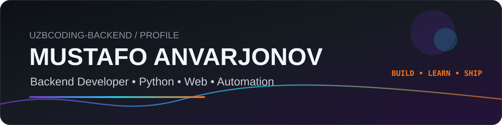
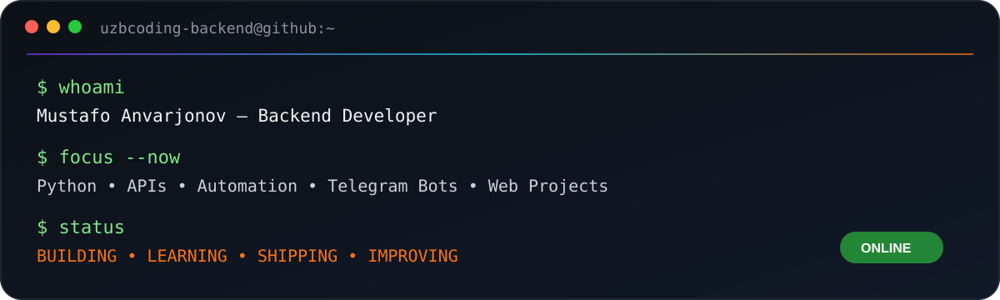

<div align="center">



<br/>

[](https://github.com/uzbcoding-Backend)
[](https://github.com/uzbcoding-Backend)
[](https://github.com/uzbcoding-Backend)

</div>

---

<div align="center">

```text
################################################################################################
##                                                                                            ##
##   ##     ## ##     ##  ######  ########    ###    ########  #######                       ##
##   ###   ### ##     ## ##    ##    ##      ## ##   ##       ##     ##                      ##
##   #### #### ##     ## ##          ##     ##   ##  ##       ##     ##                      ##
##   ## ### ## ##     ##  ######     ##    ##     ## ######   ##     ##                      ##
##   ##     ## ##     ##       ##    ##    ######### ##       ##     ##                      ##
##   ##     ## ##     ## ##    ##    ##    ##     ## ##       ##     ##                      ##
##   ##     ##  #######   ######     ##    ##     ## ##        #######                       ##
##                                                                                            ##
################################################################################################
```

### Backend Developer • Python Engineer • Automation Builder • Web Developer

</div>

---

## 👋 About Me

<table>
<tr>
<td width="64%" valign="top">

I’m **Mustafo Anvarjonov**, a backend-focused developer building practical projects with Python and web technologies.

- 🐍 Building with **Python**
- 🤖 Interested in **Telegram bots & automation**
- 🌐 Creating **web projects and APIs**
- 🧩 Learning backend architecture and databases
- 🛠️ Working with Git, GitHub and deployment workflows
- 🚀 Goal: build useful software and keep improving

</td>
<td width="36%" valign="top">

### ⚡ Developer Snapshot

**Username:** `uzbcoding-Backend`  
**Focus:** Backend / Python  
**Location:** Tashkent, Uzbekistan  
**Status:** Building & learning  
**Style:** Learn → Build → Improve

</td>
</tr>
</table>

---

## 🖥️ Developer Terminal

<div align="center">

</div>

---

## 🧠 Professional Stack

<div align="center">

### Languages


### Backend & Tools


</div>

---

## 🚀 Flagship Projects

<table>
<tr>
<td width="50%" valign="top">

### 🐍 [Python Site](https://github.com/uzbcoding-Backend/python-sayt)
Python learning and web project focused on coding practice and interactive examples.

`Python` `HTML` `CSS` `JavaScript`

</td>
<td width="50%" valign="top">

### 🎮 [Game HTML](https://github.com/uzbcoding-Backend/Game-HTML)
Browser-based game project built with frontend technologies.

`HTML` `CSS` `JavaScript`

</td>
</tr>
<tr>
<td width="50%" valign="top">

### 🌐 [VEXOR](https://github.com/uzbcoding-Backend/vexor)
Modern web project and GitHub Pages experiment.

`Web` `Frontend` `GitHub Pages`

</td>
<td width="50%" valign="top">

### 🍽️ [Restaurant](https://github.com/uzbcoding-Backend/Restuarant)
Restaurant interface project with menu and service-oriented layout.

`HTML` `CSS` `JavaScript`

</td>
</tr>
</table>

---

## 🔄 How I Build

```text
┌───────────────┐
│      IDEA     │
└───────┬───────┘
        ↓
┌───────────────┐
│      PLAN     │
└───────┬───────┘
        ↓
┌───────────────┐
│      CODE     │
└───────┬───────┘
        ↓
┌───────────────┐
│  TEST & DEBUG │
└───────┬───────┘
        ↓
┌───────────────┐
│ PUSH TO GITHUB│
└───────┬───────┘
        ↓
┌───────────────┐
│    IMPROVE    │
└───────────────┘
```

---

## 🎮 Contribution Energy

<div align="center">

<picture>
  <source media="(prefers-color-scheme: dark)" srcset="https://raw.githubusercontent.com/uzbcoding-Backend/uzbcoding-Backend/output/github-contribution-grid-snake-dark.svg">
  <source media="(prefers-color-scheme: light)" srcset="https://raw.githubusercontent.com/uzbcoding-Backend/uzbcoding-Backend/output/github-contribution-grid-snake.svg">
  
</picture>

</div>

---

## 🧭 Skill Matrix

| Area | Level | Current Focus |
|---|---|---|
| Python | ⭐⭐⭐⭐☆ | Backend, scripting, automation |
| HTML/CSS | ⭐⭐⭐⭐☆ | Modern layouts and UI |
| JavaScript | ⭐⭐⭐☆☆ | Interactive web features |
| Git/GitHub | ⭐⭐⭐⭐☆ | Repos, workflows, collaboration |
| Telegram Bots | ⭐⭐⭐⭐☆ | Useful bot flows and automation |
| APIs | ⭐⭐⭐☆☆ | Learning stronger backend patterns |

---

## 📊 GitHub Activity

<div align="center">


</div>

> I prefer stable, readable profile elements over fragile external cards that often break.

---

## 🧭 Roadmap

- [x] Build a powerful GitHub profile
- [x] Create custom profile visuals
- [x] Add contribution animation
- [x] Build multiple public projects
- [ ] Build stronger Python backend projects
- [ ] Improve API design skills
- [ ] Improve database skills
- [ ] Create more automation tools
- [ ] Publish more polished repositories
- [ ] Keep contributing and collaborating

---

## 🏆 Developer Mindset

```text
LEARN FAST
BUILD REAL THINGS
TEST EVERYTHING
SHIP OFTEN
IMPROVE CONTINUOUSLY
HELP OTHERS
```

---

## 🤝 Connect & Collaborate

<div align="center">

[](https://github.com/uzbcoding-Backend?tab=repositories)
[](https://github.com/uzbcoding-Backend)
[](https://www.youtube.com/@uzcodingdev)
[](https://t.me/cleancody)

<br/><br/>

```text
################################################################################
##                                                                            ##
##                     U Z B C O D I N G - B A C K E N D                      ##
##                                                                            ##
################################################################################
```

### BUILD • LEARN • SHIP • IMPROVE

⭐ Thanks for visiting my profile!

</div>
