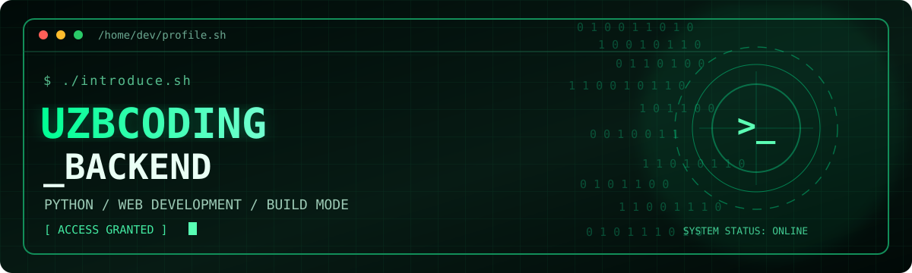
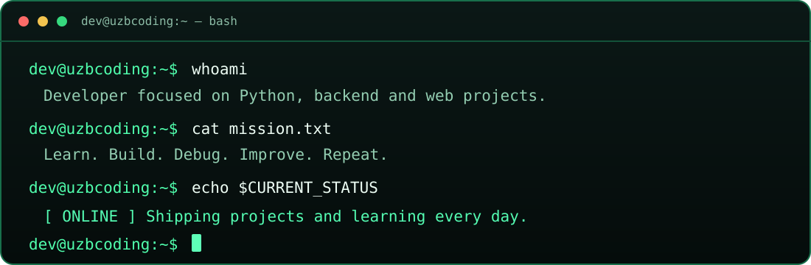

<div align="center">



[](https://github.com/uzbcoding-Backend)
[](https://github.com/uzbcoding-Backend?tab=repositories)
[](https://github.com/uzbcoding-Backend?tab=repositories)

**`[ ACCESS GRANTED ]`** &nbsp; **`[ CODE MODE: ON ]`** &nbsp; **`[ LEARNING IN PROGRESS ]`**

</div>

## `> whoami`



I'm **Mustafo**, a developer interested in **Python**, **backend engineering**, **JavaScript**, and **useful web apps**. I like creating projects, experimenting with tools, and improving my code with every version.

```python
class Developer:
    username = "uzbcoding-Backend"
    focus = ["Python", "Backend", "Web Development"]
    mindset = "learn -> build -> debug -> improve"

    def next_step(self):
        return "Build something useful."
```

## `> ls ./tech-stack`

<div align="center">


</div>

## `> cat ./featured-projects.md`

| Project | What it does | Source |
|:---|:---|:---:|
| **☕ Java Mastery Course** | Interactive Java lessons and quizzes | [OPEN](https://github.com/uzbcoding-Backend/Java-Mastery-Course) |
| **📚 Study Planner Pro** | Study tasks, deadlines, progress tracking | [OPEN](https://github.com/uzbcoding-Backend/Study-Planner-Pro) |
| **🛍️ NOVA Shop** | Demo e-commerce storefront and cart | [OPEN](https://github.com/uzbcoding-Backend/NOVA-Shop) |
| **🍽️ Urban Plate** | Restaurant menu, cart, demo reservations | [OPEN](https://github.com/uzbcoding-Backend/Restuarant) |
| **🐍 Python Site** | Python learning and coding experiments | [OPEN](https://github.com/uzbcoding-Backend/python-sayt) |
| **🎮 Game HTML** | Interactive browser game project | [OPEN](https://github.com/uzbcoding-Backend/Game-HTML) |
| **🧪 CodeForge Lab** | Seven small interactive developer tools | [OPEN](https://github.com/uzbcoding-Backend/test) |
| **🌐 Vexor** | Web and GitHub Pages experiments | [OPEN](https://github.com/uzbcoding-Backend/vexor) |

<div align="center">

[](https://github.com/uzbcoding-Backend?tab=repositories)

</div>

## `> systemctl status dev-mode`

| Module | Status |
|:---|:---|
| Python foundations | `ACTIVE` |
| Backend & API design | `LEARNING` |
| Web applications | `BUILDING` |
| Databases and deployment | `EXPLORING` |
| Clean code & testing | `IMPROVING` |

## `> git status --short`

```diff
+ Building new projects
+ Learning new technologies
+ Improving existing code
! More ideas than hours in the day
```

## `> ./connect.sh`

<div align="center">

[](https://github.com/uzbcoding-Backend?tab=repositories)
[](https://github.com/uzbcoding-Backend)

**`CODE. DEBUG. BUILD. REPEAT.`**

<sub>Cyber-themed developer portfolio · Building practical projects and learning every day.</sub>

</div>