<div align="center">



<br/>

[](https://github.com/uzbcoding-Backend)
[](https://github.com/uzbcoding-Backend?tab=repositories)
[](https://github.com/uzbcoding-Backend?tab=repositories)

<sub>⚡ Curious mind. Practical code. Better projects with every commit.</sub>

</div>

---

<div align="center">

### THE NAME, BUILT WITH CODE

```text
  #   #  #   #   ####  #####   ###   #####   ### 
  ## ##  #   #  #        #    #   #  #      #   #
  # # #  #   #  #        #    #   #  #      #   #
  #   #  #   #   ###     #    #####  ####   #   #
  #   #  #   #      #    #    #   #  #      #   #
  #   #  #   #      #    #    #   #  #      #   #
  #   #   ###   ####     #    #   #  #       ### 
```

**MUSTAFO · UZBCODING-BACKEND**

</div>

---

## 🌌 THE DEVELOPER BEHIND THE CODE

<table>
<tr>
<td width="62%" valign="top">

### 👋 Hey, I'm Mustafo!

I'm **Mustafo Anvarjonov**, a developer from **Tashkent, Uzbekistan**, focused on growing as a **Python backend engineer**.

I build and experiment with **web projects, Telegram bots, automation scripts, and programming tools**. I enjoy turning an idea into something people can actually open, use, and improve.

- **Currently building:** Python, web and bot projects
- **Currently exploring:** APIs, backend patterns and AI
- **I value:** Useful features, clean code and steady progress
- **My approach:** Learn → Build → Debug → Improve → Share

</td>
<td width="38%" valign="top">

### 🧬 DEVELOPER DNA

| | |
|:--|:--|
| **Alias** | `uzbcoding-Backend` |
| **Focus** | Python / Backend |
| **Based in** | Tashkent, Uzbekistan |
| **Also working with** | HTML · CSS · JS |
| **Tools** | Git · GitHub · VS Code |
| **Project mode** | Learning & building |

<code>while learning:</code>  
<code>    build_something()</code>

</td>
</tr>
</table>

---

## 💻 MY DEVELOPMENT TERMINAL

<div align="center">


</div>

---

## 🧰 TECH STACK // MY TOOLKIT

<div align="center">

**LANGUAGES**


**TOOLS & WORKFLOW**


**LEARNING & EXPLORING**


</div>

---

## 🪐 THE PROJECT UNIVERSE

> Real repositories from my GitHub — click a project to explore its code.

<table>
<tr>
<td width="50%" valign="top">

### 🐍 [PYTHON SITE](https://github.com/uzbcoding-Backend/python-sayt)

**LEARN • PRACTICE • BUILD**

Python learning website and web experiments.

[](https://github.com/uzbcoding-Backend/python-sayt)

</td>
<td width="50%" valign="top">

### 🎮 [GAME HTML](https://github.com/uzbcoding-Backend/Game-HTML)

**PLAY • CODE • EXPLORE**

Browser game and interactive web development project.

[](https://github.com/uzbcoding-Backend/Game-HTML)

</td>
</tr>
<tr>
<td width="50%" valign="top">

### 🌐 [VEXOR](https://github.com/uzbcoding-Backend/vexor)

**DESIGN • WEB • EXPERIMENT**

A personal website and GitHub Pages project.

[](https://github.com/uzbcoding-Backend/vexor)

</td>
<td width="50%" valign="top">

### 🍽️ [RESTAURANT](https://github.com/uzbcoding-Backend/Restuarant)

**MENU • WEBSITE • UI**

Restaurant-themed web interface and service concepts.

[](https://github.com/uzbcoding-Backend/Restuarant)

</td>
</tr>
<tr>
<td width="50%" valign="top">

### 🔬 [TEST LAB](https://github.com/uzbcoding-Backend/test)

**GIT • EXPERIMENT • COLLABORATE**

A playground for GitHub workflows and collaboration practice.

[](https://github.com/uzbcoding-Backend/test)

</td>
<td width="50%" valign="top">

### 🏅 [GITHUB ACHIEVEMENTS GUIDE](https://github.com/uzbcoding-Backend/Simple-guide-to-earning-GitHub-Achievements)

**LEARN • DOCUMENT • SHARE**

A guide-style repository about GitHub achievements.

[](https://github.com/uzbcoding-Backend/Simple-guide-to-earning-GitHub-Achievements)

</td>
</tr>
</table>

<div align="center">

[](https://github.com/uzbcoding-Backend?tab=repositories)

</div>

---

## ⚙️ FROM IDEA TO RELEASE

<div align="center">


</div>

<details>
<summary><b>🔍 View my development checklist</b></summary>

- [x] Understand the problem and outline the feature
- [x] Build a working first version
- [x] Test, debug and improve the experience
- [x] Use Git and GitHub to track changes
- [ ] Improve documentation and testing across projects
- [ ] Learn more about databases and API design
- [ ] Deploy larger backend projects

</details>

---

## 🐍 CONTRIBUTION ENGINE

<div align="center">

**Code, commit, improve — watch the activity move.**

<picture>
<source media="(prefers-color-scheme: dark)" srcset="https://raw.githubusercontent.com/uzbcoding-Backend/uzbcoding-Backend/output/github-contribution-grid-snake-dark.svg" />
<source media="(prefers-color-scheme: light)" srcset="https://raw.githubusercontent.com/uzbcoding-Backend/uzbcoding-Backend/output/github-contribution-grid-snake.svg" />

</picture>

<sub>Generated from my GitHub contributions using a repository workflow.</sub>

</div>

---

## 📡 LIVE GITHUB SIGNALS

<div align="center">


</div>

| What I'm working toward | Progress |
|:--|:--|
| Python foundations and problem solving | Building and practicing |
| Backend architecture and API design | Learning |
| Web applications and interactive UX | Building projects |
| Telegram bots and useful automation | Exploring and developing |
| Database design and deployment | Next steps |

---

## 🧭 THE ROADMAP

<table>
<tr>
<td width="50%" valign="top">

### ✅ BUILT SO FAR

- GitHub profile portfolio
- Python learning experiments
- Browser game projects
- Restaurant website concept
- Practice repositories and Git workflows

</td>
<td width="50%" valign="top">

### 🎯 NEXT MISSIONS

- More robust Python backend systems
- Better APIs and databases
- Clean documentation and tests
- Stronger Telegram automation
- Full-stack project deployment

</td>
</tr>
</table>

---

## 🤝 LET'S BUILD SOMETHING USEFUL

<div align="center">

[](https://github.com/uzbcoding-Backend)
[](https://www.youtube.com/@uzcodingdev)
[](https://t.me/cleancody)

### `uzbcoding-Backend`

**WRITE CODE. SOLVE PROBLEMS. KEEP LEARNING.**

```text
################################################################################
##                                                                            ##
##                BUILD  •  LEARN  •  SHIP  •  IMPROVE                          ##
##                                                                            ##
################################################################################
```

<sub>⭐ Thanks for exploring my profile!</sub>

</div>
