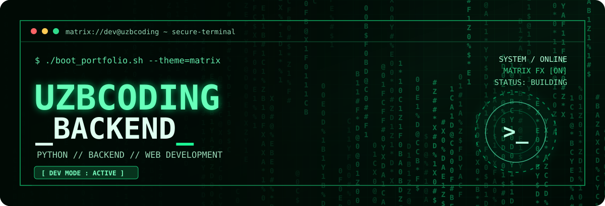
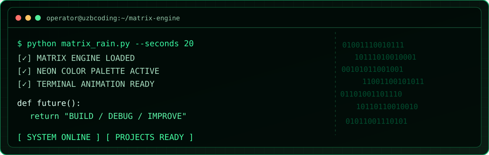
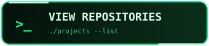
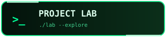
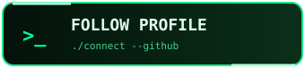

<div align="center">



<br>

**`[ ACCESS GRANTED ]`** &nbsp; **`[ SYSTEM ONLINE ]`** &nbsp; **`[ DEV MODE ACTIVE ]`**

[](https://github.com/uzbcoding-Backend?tab=repositories)
[](https://github.com/uzbcoding-Backend?tab=repositories)
[](https://github.com/uzbcoding-Backend/blob/main/matrix_rain.py)

</div>

## `> INITIALIZE // DEVELOPER PROFILE`



```console
dev@uzbcoding:~$ whoami
uzbcoding-Backend
dev@uzbcoding:~$ cat mission.txt
Learn. Build. Debug. Improve. Repeat.
dev@uzbcoding:~$ echo $CURRENT_STATUS
[ ONLINE ] [ PYTHON ] [ BACKEND ] [ WEB DEVELOPMENT ]
```

I'm **Mustafo**, an aspiring developer exploring **Python**, **backend engineering**, **web applications**, and creative tools. I enjoy building real projects, breaking down difficult ideas, and refining every new version.

## `> NAVIGATION // CYBER CONTROL PANEL`

<div align="center">

<a href="https://github.com/uzbcoding-Backend?tab=repositories"></a>
<a href="https://github.com/uzbcoding-Backend/test"></a>
<a href="https://github.com/uzbcoding-Backend"></a>

</div>

## `> EXECUTE // THE MATRIX ENGINE`

**A real, runnable terminal animation, made with Python and the standard library.** No hacking, no external services — just moving green characters, flowing streams and terminal rendering.

```python
from dataclasses import dataclass
import random

@dataclass
class CodeStream:
    column: int
    head: float
    speed: float
    length: int

    def advance(self, delta: float, height: int) -> None:
        self.head += self.speed * delta
        if self.head - self.length > height:
            self.head = -random.randint(1, height)
            self.speed = random.uniform(8, 29)

def illuminate(column: int, head: int, length: int, height: int):
    """Yield visible characters from one moving stream."""
    glyphs = "01ABCDEFGHIJKLMNOPQRSTUVWXYZ#$%&*"
    for tail in range(length):
        row = head - tail
        if 0 <= row < height:
            intensity = "HEAD" if tail == 0 else "GLOW" if tail < 3 else "DIM"
            yield row, column, random.choice(glyphs), intensity

print("[ MATRIX CORE ONLINE // BUILD SOMETHING GREAT ]")
```

<div align="center">

[](./matrix_rain.py)

</div>

**Run the full animation locally:**

```bash
python matrix_rain.py --seconds 20 --fps 24 --density 0.58
```

> The SVG banner contains animated Matrix-style glyphs. Some GitHub viewers or reduced-motion settings may show a static frame instead.

## `> LOAD MODULES // TECH STACK`

<div align="center">


</div>

## `> LS PROJECTS/ --ALL`

| Project | Mission | Source |
|:--|:--|:--:|
| **Java Mastery Course** | Java lessons, examples and quizzes | [OPEN](https://github.com/uzbcoding-Backend/Java-Mastery-Course) |
| **Study Planner Pro** | Organize subjects, tasks and deadlines | [OPEN](https://github.com/uzbcoding-Backend/Study-Planner-Pro) |
| **NOVA Shop** | Demo online shop with a functional cart | [OPEN](https://github.com/uzbcoding-Backend/NOVA-Shop) |
| **Urban Plate** | Restaurant menu and demo reservations | [OPEN](https://github.com/uzbcoding-Backend/Restuarant) |
| **Python Site** | Python practice and learning platform | [OPEN](https://github.com/uzbcoding-Backend/python-sayt) |
| **Game HTML** | Interactive browser game | [OPEN](https://github.com/uzbcoding-Backend/Game-HTML) |
| **CodeForge Lab** | Seven developer mini-projects | [OPEN](https://github.com/uzbcoding-Backend/test) |
| **VEXOR** | Frontend design experiments | [OPEN](https://github.com/uzbcoding-Backend/vexor) |

## `> MONITOR // LIVE SIGNALS`

<div align="center">


**`sudo imagination --unlimited`**

<sub>⚡ Cyber visuals • Original code • Real projects • Always learning</sub>

</div>
